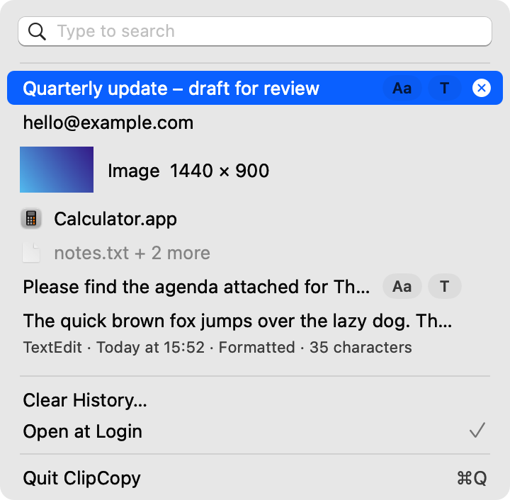
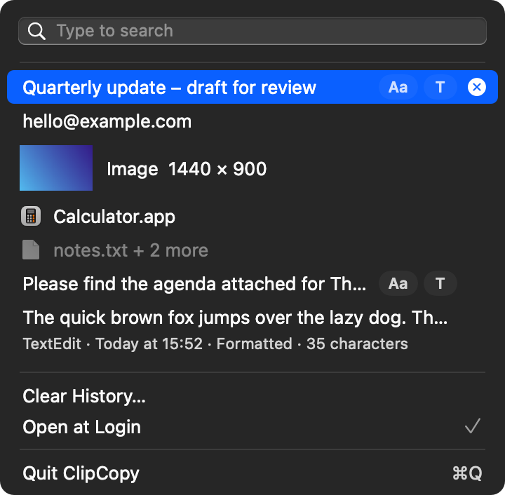

# ClipCopy

A lightweight clipboard history for the macOS menu bar. Click the paperclip, pick something you copied earlier, and choose whether it comes back **with its formatting** or as **plain text**.

 

## What it does

- **Remembers what you copy:** text (plain or formatted), images and files copied in Finder. The newest 1,000 clips are kept; older ones are deleted automatically.
- **Plain by default, formatting when you want it:** clicking a clip copies it as plain text. Formatted clips also have two buttons: **Aa** copies the clip exactly as it was, with fonts, colours and links, and **T** copies plain text.
- **Tidier plain text:** plain copies also swap the look-alike spaces that Word and web pages use (non-breaking, narrow and thin spaces) for ordinary ones, and removes invisible characters such as zero-width spaces and soft hyphens. Those are what show up as "?" or odd gaps when pasted elsewhere. Line breaks, tabs, quotes and emoji are left alone.
- **Search everything:** type as soon as the dropdown opens to search all 1,000 clips.
- **No duplicates:** copying something that's already in the history moves it to the top. If the same words arrive again with formatting, the formatting is added to the existing clip.
- **Details on hover:** the line under the clips shows where the highlighted clip came from, when you copied it, and what it is.
- **Delete one clip** with the **×** on the highlighted row, or everything with **Clear History…**.
- **Copy only:** picking a clip puts it on the clipboard; you paste with ⌘V. ClipCopy needs no special permissions.
- **Light on memory:** it reads the clips it shows and nothing else. Activity Monitor shows about 15 MB at rest and about 25 MB after heavy use with a full history.

## Using it

| | |
|---|---|
| Open | Click the paperclip in the menu bar |
| Search | Just start typing |
| Move | ↑ ↓, or the pointer |
| Copy as plain text | Return, or click the row |
| Copy with formatting | **Aa** on formatted rows (**T** is plain, like a click) |
| Delete a clip | **×** on the highlighted row |
| Clear the search, then close | Esc |

ClipCopy turns on **Open at Login** the first time it runs. Switch it off in the dropdown.

## Privacy

ClipCopy records **everything** you copy, including passwords copied from a password manager. It doesn't skip them. The history stays on your Mac, in `~/Library/Application Support/ClipCopy`, and only your user account can read it. Nothing is sent anywhere. Deleted clips are overwritten in the database, not just unlinked.

## Building

Needs an Apple Silicon Mac on macOS 13 or later, and Swift (the Command Line Tools are enough; Xcode isn't needed).

```bash
scripts/make-signing-identity.sh   # once, optional: keeps the login item working across rebuilds
scripts/build.sh --install         # builds, installs to /Applications and starts ClipCopy
```

The icon is drawn in code (`Sources/ClipCopy/Paperclip.swift`). `scripts/make-icon.sh` regenerates `Resources/AppIcon.icns` from it.

## Testing

```bash
BIN="$(swift build -c release --arch arm64 --show-bin-path)"
"$BIN/ClipCopy" --self-test                       # store, search, limits, plain-text tidy, clipboard reads and writes
"$BIN/ClipCopy" --render-test /tmp/clipcopy       # draws the dropdown and icons to PNGs
"$BIN/ClipCopy" --data-dir /tmp/cc --fill 1000    # a separate history full of sample clips
"$BIN/ClipCopy" --data-dir /tmp/cc --menu-test    # drives the real dropdown and reports memory
```

None of these touch your real history. `--menu-test` presses real keys, but only while ClipCopy's dropdown has the keyboard, and it copies to a private pasteboard. The app running it (Terminal, say) needs permission to control the computer in **System Settings › Privacy & Security › Accessibility**.

## How it works

- **Watching the clipboard:** macOS has no "clipboard changed" event, so ClipCopy checks the clipboard's change counter twice a second, which costs next to nothing.
- **Storage:** text, formatting (RTF and HTML) and details live in SQLite; images are saved as PNG with a small thumbnail beside it; files are stored as paths.
- **The dropdown:** a panel styled like a menu, not an `NSMenu`. Menus keep the keyboard to themselves, so a search box and per-row buttons don't work reliably inside one. The panel takes the keyboard without making ClipCopy the active app, so the app you were in stays in front.
- **Limits:** text over 20 MB isn't saved, formatting over 10 MB is dropped (the text is kept), and images over 50 MB aren't saved.

## Licence

MIT. See [LICENSE](LICENSE).
